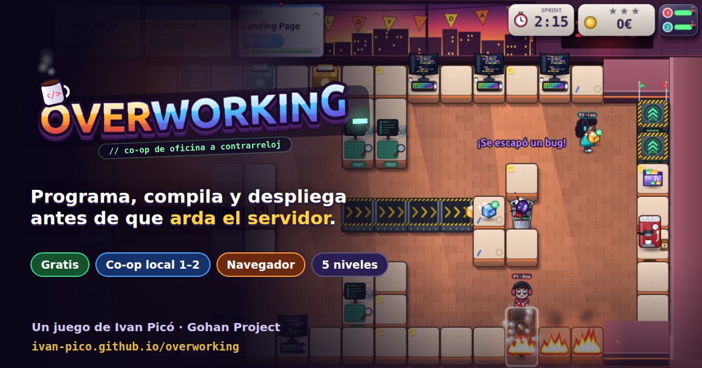

# OVERWORKING

> Co-op de oficina a contrarreloj: programa, compila, testea y despliega antes de que caduque el ticket.

**[▶ Jugar online en overworking.gohan.cat](https://overworking.gohan.cat/)**



OVERWORKING es un juego cooperativo de 1–2 jugadores inspirado en las cocinas frenéticas, ambientado en
una oficina de programadores. Los «platos» son *features* que piden los clientes: hay que coger el
requisito, programarlo, compilarlo, testearlo, meterlo en un Pull Request y desplegarlo a producción.
Todo ello mientras arden servidores, se escapan bugs y el manager pregunta si tienes «5 minutitos».

## Características

- **Co-op local** para 2 jugadores (teclado compartido o mandos) o **1 jugador** controlando a dos devs.
- **5 niveles** con mapas propios y peligros nuevos en cada uno.
- **4 dificultades**: Becario Feliz, Junior Optimista (por defecto), Senior Cafeinado y Rockstar 10x.
- **Gráficos y audio 100 % generados por código**: sin imágenes, sonidos ni dependencias externas.
- Funciona **sin instalación ni servidor**: abre `index.html` y juega. También es instalable como PWA.
- **Panel de ajustes** para desarrolladores (F9) para equilibrar el juego en vivo.

## Empezar

### Online

Abre **https://overworking.gohan.cat/** en un navegador de escritorio moderno.

### En local

```bash
git clone git@github.com:ivan-pico/overworking.git
cd overworking
xdg-open index.html   # o doble clic en index.html (macOS: open index.html)
```

No hace falta build ni servidor. El audio se activa al pulsar la primera tecla.

## Controles

| Acción | Jugador 1 | Jugador 2 | Mando |
|---|---|---|---|
| Mover | `W A S D` | Flechas | Stick / cruceta |
| Coger / dejar | `E` | `.` (punto) | A |
| Acción (mantener) | `F` | `,` (coma) | X |
| Dash | `Shift` izq. | `-` / `/` | B |
| Cambiar de dev (1 jugador) | `Tab` | `Tab` | Y |
| Pausa | `Esc` / `P` | `Esc` / `P` | Start |
| Silenciar | `M` | `M` | — |

Los menús se manejan con flechas/WASD + `Enter`, con el ratón o con el mando.

## Cómo se juega

Cada pedido pide uno o varios módulos de color: **Front** 🔵, **Back** 🟢 y **Data** 🟠.
Cada módulo recorre esta cadena:

1. **Impresora** de su color → coges la *spec*.
2. **Escritorio** → mantén *Acción* → código.
3. **Servidor de build** → compila solo. Si lo olvidas, **SEGFAULT** y fuego: apágalo con el extintor **HOTFIX**.
4. **Banco de tests** → mantén *Acción* → módulo testeado ✔. A veces se escapa un bug: aplástalo.
5. **Pull Request** → mete dentro los módulos que pide el pedido (uno de cada color, como mucho).
6. **Deploy** → entrega el PR. Cuanto más rápido, más propina.

| Pedido | Módulos | | Pedido | Módulos |
|---|---|---|---|---|
| Landing Page | 🔵 | | Dashboard | 🔵 🟠 |
| API REST | 🟢 | | Microservicio | 🟢 🟠 |
| Migración BD | 🟠 | | App Full-Stack | 🔵 🟢 🟠 |
| Login | 🔵 🟢 | | | |

Además, los PR desplegados vuelven «con comentarios» y hay que limpiarlos en la estación de review
(el pato de goma 🦆). Los devs se cansan y necesitan **café**. Con 1–3 estrellas por nivel se
desbloquea el siguiente, y el progreso se guarda en el navegador.

La web del juego incluye una guía ilustrada paso a paso bajo la pantalla de juego.

## Niveles

| # | Nivel | Novedad |
|---|---|---|
| 1 | El Garaje | Tutorial guiado; Front y Back, sin peligros |
| 2 | Startup Open Space | Los tres colores y bugs |
| 3 | La Consultora | El manager y sus «5 minutitos» (el dash lo esquiva) |
| 4 | El Datacenter | Cintas transportadoras, servidores que se recalientan antes, luz tenue |
| 5 | Viernes 17:59 · Deploy Day | Todo a la vez y apagones |

La dificultad se elige en **Opciones**.

## Desarrollo

HTML5 Canvas y JavaScript *vanilla* con scripts clásicos (sin módulos ES ni `fetch`), para que funcione
también abriendo el fichero con `file://`. Todo cuelga del espacio de nombres global `window.OW`.

### Estructura

```
index.html              punto de entrada, metadatos SEO y guía «Cómo se juega»
css/                    estilos de la página y del panel de ajustes
js/audio.js             OW.Audio: música y efectos sintetizados con WebAudio
js/art/                 OW.Art / OW.FX: dibujo procedural (personajes, estaciones, objetos, UI, partículas)
js/core/                lógica del juego
  tuning.js             todos los parámetros de equilibrio (OW.TUNING), comentados
  config.js             constantes, utilidades, guardado y dificultades
  levels.js             recetas, mapas 18×9 y textos de cada nivel
  entities.js           jugadores, bugs y manager
  game.js               partida: estaciones, pipeline, pedidos y peligros
  hud.js · menus.js     interfaz de partida y pantallas
  input.js              teclado, mandos y ratón
  devpanel.js           panel de ajustes (F9)
  main.js               bucle principal (paso fijo 60 Hz) y ganchos de depuración
  fallbacks.js          sustitutos mínimos si falta el arte o el audio
js/page.js              pausa la partida al bajar a leer la página
icons/ · img/           iconos de la app, imagen social e ilustraciones de la guía
tools/                  galería de arte y banco de pruebas de audio
```

### Ajustar el equilibrio

Todos los valores (velocidad de los devs, café, manager, tiempos del pipeline, puntos, dificultades y
parámetros de cada nivel) están en [`js/core/tuning.js`](js/core/tuning.js), con un comentario por valor.

Para probar cambios sin tocar código, pulsa **F9** en el juego (o abre `index.html?dev=1`):

- Pestañas *Jugador*, *Pipeline y pedidos*, *Dificultades* y *Niveles*, con tablas editables.
- `●` se aplica al instante; `↻` al empezar un nivel (botón **Reiniciar nivel con estos ajustes**).
- Los cambios se guardan solo en ese navegador. **Exportar tuning.js** genera el fichero completo para
  sustituir `js/core/tuning.js` y hacerlos permanentes.

### Depuración

- `index.html?level=3&players=2&skipintro=1` arranca directamente un nivel.
- `index.html?screen=levels` abre una pantalla (`menu`, `options`, `controls`, `credits`, `levels`).
- En la consola: `OW.debug.state()`, `OW.debug.startLevel(n, jugadores)`, `OW.debug.skipTime(s)`,
  `OW.debug.unlockAll()`.

## Despliegue

El juego es estático y se publica con GitHub Pages en un dominio propio:

1. *Settings → Pages → Deploy from a branch*: rama `main`, carpeta `/ (root)`.
2. *Custom domain*: `overworking.gohan.cat` (ya indicado en el fichero `CNAME`). En el DNS de gohan.cat:
   `CNAME overworking → ivan-pico.github.io`.
3. Opcional: dar de alta el sitio en Google Search Console y enviar `sitemap.xml`.

Si cambia la URL pública, actualízala en `index.html` (canonical, Open Graph y JSON-LD), `sitemap.xml`,
`robots.txt` y `CNAME`.

## Créditos

Creado por **Ivan Picó** · [Gohan Project](https://gohan.cat), con la ayuda de Claude Code.

## Licencia

[GPL-3.0](LICENSE)
